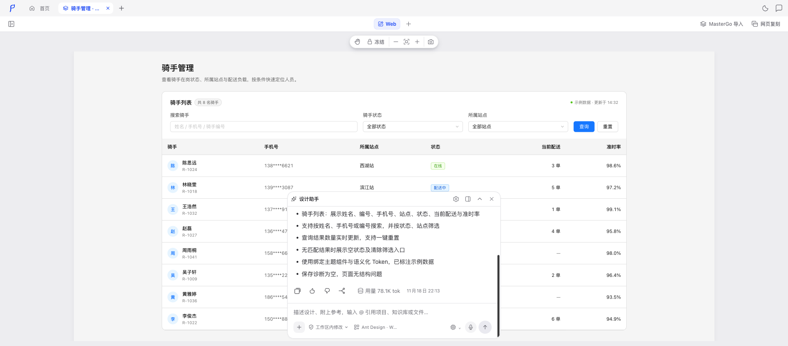
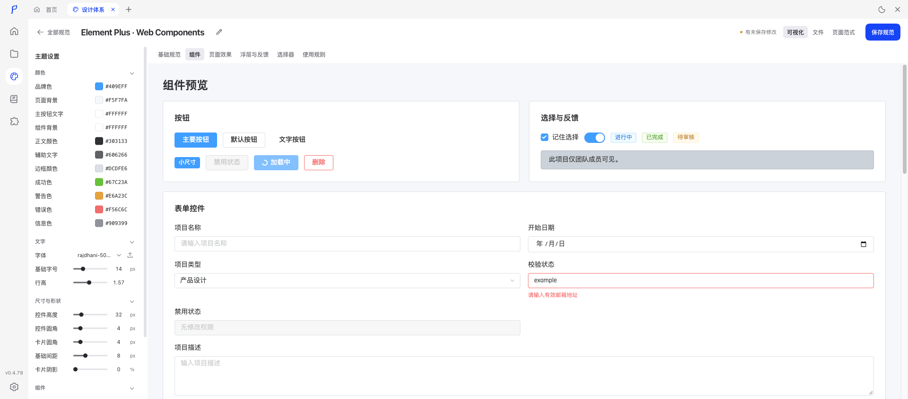

# DSH Designer · 设计师工作台

在 DeepSeek Harness（DSH）里，把一句页面需求变成可以点击、填写和演示的 HTML 设计稿。你可以让 AI 继续修改整个页面，也可以停在某个已经打开的弹窗里，只调一个按钮、一段文字或一张图片。



## 安装到 DSH

**无法访问 GitHub 时**，复制下面的地址，打开 DSH 的 **插件 → 添加插件**，粘贴并确认。它指向已经验证的 0.4.80 安装包。安装完成后，从侧栏打开「设计师模式」。

```text
https://ghfast.top/https://github.com/percentcola3/dsh-designer/releases/download/v0.4.80/dsh-designer.tgz
```

**团队内部分发**也可以使用同一个文件。由一人[下载 0.4.80 安装包](https://ghfast.top/https://github.com/percentcola3/dsh-designer/releases/download/v0.4.80/dsh-designer.tgz)并核对下方校验值，通过内网或文件传输发给同事。收件人在「添加插件」中填写文件的本地绝对路径即可。首次安装仍需能访问 DSH 配置的 npm 源，以便获取运行依赖。

<details>
<summary>校验镜像或转发的安装包</summary>

0.4.80 官方发行包共 4,748,487 字节，SHA-256 为：

```text
158aad36668e979a8662932f5e5eee37dca18aab231d72002faa76a42136758f
```

在下载目录执行 `shasum -a 256 dsh-designer.tgz`（macOS）、`sha256sum dsh-designer.tgz`（Linux）或 `Get-FileHash .\dsh-designer.tgz -Algorithm SHA256`（Windows PowerShell），核对结果一致后安装。镜像由第三方运营，此校验值仅适用于上述版本。

</details>

**可以访问 GitHub 时**，也可以把下面这句话发给 DSH 标准模式的对话，让插件管理器安装最新稳定版：

```text
请用 DSH 插件管理器安装 https://github.com/percentcola3/dsh-designer/releases/latest/download/dsh-designer.tgz
```

## 从需求生成页面

新建项目，选好设计规范，描述页面要解决的问题。例如：

> 用 Ant Design 风格做一个骑手管理页。列表展示姓名、站点、配送状态和当前单量。支持按站点筛选，点击骑手后打开详情抽屉。

生成过程中可以在设计助手里查看 AI 的输出、工具调用和待确认操作。页面生成后，直接点击筛选、打开抽屉，检查实际交互。需要改动时，可以把选中的元素、项目文件或知识库资料加入对话，让 AI 知道你具体指哪一处。

## 微调正在看的界面

例如，要调整详情抽屉里的头像，先在设计稿中打开抽屉，再从悬浮工具栏选择「冻结页面」。拾取头像后，在属性面板里替换图片或拖入新文件。文字和容器也可以调整位置、尺寸、字号及颜色。选择「恢复交互」，就能接着体验页面；评审时可以框选区域，将截图复制到剪贴板。

## 用团队的设计规范生成

在「设计体系」选择桌面端的 Ant Design、Element Plus、Arco Design、HeroUI 风格，或移动端的 Vant 风格。左侧调整品牌色、字体、间距和圆角，右侧实时对照按钮、表单、选择器、弹窗及整页效果。可以上传品牌字体，随规范一起保存。「使用规则」记录 AI 在哪些场景应该使用哪些组件。



## 复刻已有网页，交付本地设计稿

在项目中打开「网页复刻」，设置桌面或移动视口，然后操作并录制需要的页面。对于单页应用（SPA），可以依次进入列表、详情和弹窗，再选择「结束并复刻」。插件会把已录制的界面和可采集的静态资源保存为独立设计稿。需要原站接口或懒加载内容的步骤，应先在录制中实际走到。

设计稿以 HTML 为入口。交付时将页面和配套样式、脚本、图片、字体一起导出，接收方即可打开查看。项目知识库还可以集中管理需求文档、品牌资料和参考文件，供后续设计对话引用。

## 本地开发

推荐 Node.js 24。在独立仓库根目录运行：

```sh
npm ci --ignore-scripts
npm run build
npm run dev
```

`dev` 使用本机安装的 DSH Desktop 启动隔离的 Web 调试实例，测试项目存放在 `.build/`。修改组件与界面可从 `ui/` 和 `editor/` 开始。相关命令和发布流程见[调试说明](DEBUGGING.md)、[贡献指南](CONTRIBUTING.md)和[版本记录](CHANGELOG.md)。

原创代码采用 [MIT 许可](LICENSE)。第三方组件、字体和资源沿用各自的许可，见 [licenses](licenses) 和 [Ant Design 模板声明](templates/antd/assets/LICENSE.txt)。
